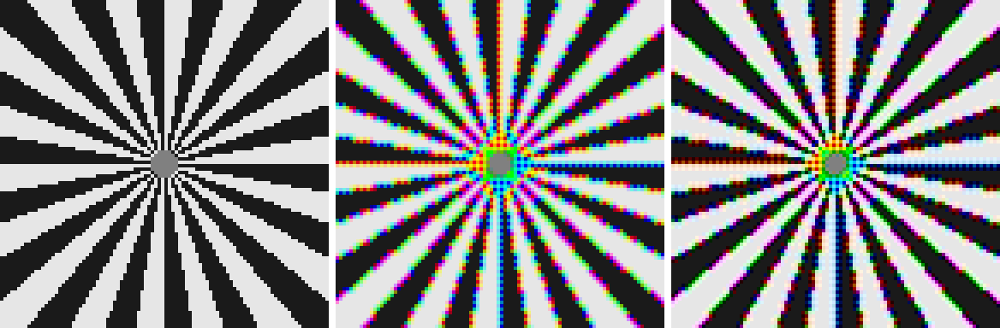
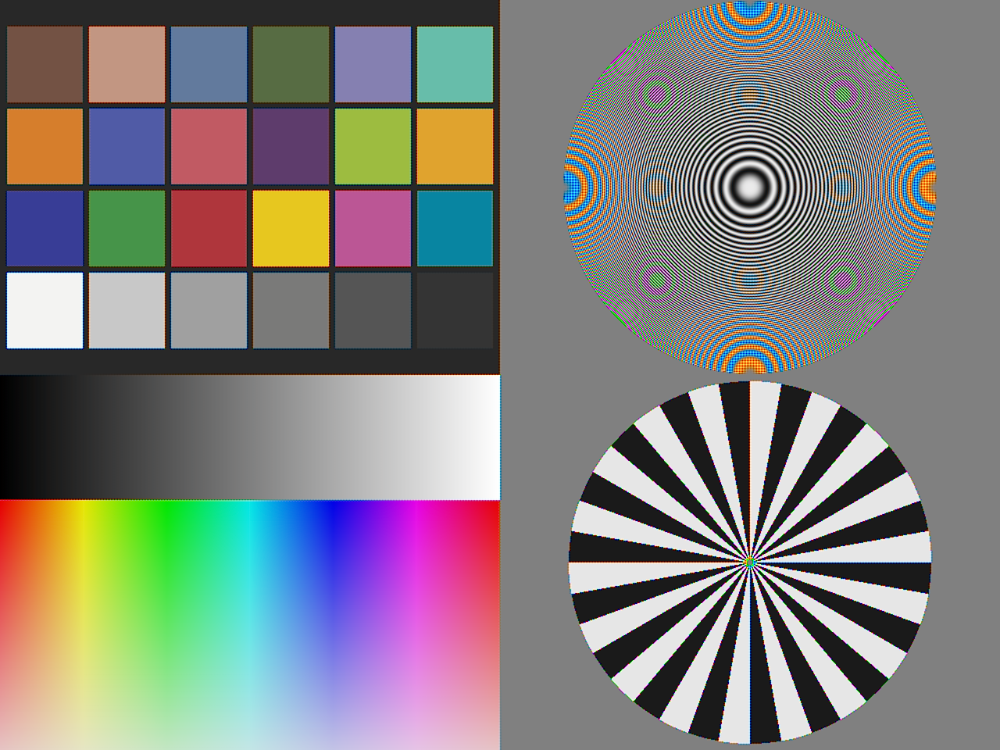

# Camera ISP Pipeline Simulator

A camera image signal processor (ISP) written from scratch in C++17. It turns a raw Bayer sensor frame into a display-ready sRGB image, one stage at a time, the way the ISP block in a phone or automotive SoC does. Every stage is multithreaded, and the output is scored against a known ground truth.

No external libraries: the code reads and writes Netpbm and BMP files itself and builds with CMake on Windows, Linux and macOS.



*Left to right: ground truth, bilinear demosaicing, Malvar-He-Cutler demosaicing (zoomed 4x). Bilinear blurs the spokes and fringes them with false colour; the gradient-corrected method keeps them sharper.*

## Pipeline

```
RAW (12-bit Bayer) -> Black Level -> Defect Correction -> White Balance -> Demosaic -> Color Correction -> Gamma -> sRGB (8-bit)
```

| Stage | What it does | Implementation notes |
| --- | --- | --- |
| Black Level | Subtracts the sensor's zero-light offset and scales to [0, 1] | Clamps negatives produced by read noise |
| Defect Correction | Finds hot and dead pixels and replaces them | Compares each pixel with its 8 same-colour neighbours two pixels away; replaces outliers with their median. Works for any Bayer layout without knowing it |
| White Balance | Removes the illuminant's colour cast | Applied on the mosaic before demosaicing, as hardware ISPs do. Gains come from metadata or a gray-world estimate |
| Demosaic | Rebuilds full RGB at each pixel from one measured channel | Bilinear, or Malvar-He-Cutler (2004): bilinear plus a correction from the measured channel's Laplacian, using 5x5 kernels |
| Color Correction | Maps camera RGB to linear sRGB | 3x3 matrix whose rows sum to 1, so greys stay grey |
| Gamma | Encodes linear light for display | sRGB transfer curve through a 65536-entry lookup table instead of `pow` per sample |

All four Bayer layouts (RGGB, BGGR, GRBG, GBRG) are supported.

## Where the Raw Data Comes From

`make-raw` runs the ISP backwards on an ordinary sRGB image: undo gamma, undo the colour matrix, undo white balance, sample through the Bayer filter, add black level and noise, quantise to 12 bits, and inject hot pixels. Because the original image is known, the forward pipeline's output can be measured against it with PSNR.

The built-in test chart is designed to stress an ISP. ColorChecker-style patches test colour accuracy; a zone plate and a Siemens star contain detail finer than a Bayer sensor can resolve, which is where demosaicing algorithms differ most.



*The test chart after the full pipeline. The coloured rings in the zone plate are the classic Bayer aliasing (moire) pattern, which appears once detail is finer than the red and blue sampling grid.*

## Build

Windows (Visual Studio 2019 or later, from a Developer PowerShell):

```powershell
cmake -S . -B build
cmake --build build --config Release
.\build\Release\isp_tests.exe
.\build\Release\isp_sim.exe demo out
```

Linux, macOS or WSL:

```bash
cmake -S . -B build -DCMAKE_BUILD_TYPE=Release
cmake --build build -j
./build/isp_tests
./build/isp_sim demo out
```

The demo writes every intermediate image, zoomed comparisons and `out/results.md` with all measurements.

## Commands

```
isp_sim demo <out_dir>                     Scene, raws, quality scores and benchmark in one run
isp_sim scene <out.ppm>                    Write the synthetic test chart
isp_sim make-raw <in.ppm> <out_prefix>     Simulate a raw: writes <prefix>.pgm and <prefix>.txt
isp_sim run <raw.pgm> <meta.txt> <out.bmp> Process a raw into sRGB
isp_sim bench <raw.pgm> <meta.txt>         Time each stage across thread counts
```

Useful options for `run`: `--demosaic bilinear|malvar`, `--threads N`, `--no-dpc`, `--gray-world`, `--ref truth.ppm` (prints PSNR), `--dump-dir DIR` (saves each stage). For `make-raw`: `--noise`, `--hot-fraction`, `--seed`, `--pattern`.

To try your own photo:

```bash
python tools/image_to_ppm.py photo.jpg photo.ppm --max-side 2048
./build/isp_sim make-raw photo.ppm photo_raw
./build/isp_sim run photo_raw.pgm photo_raw.txt photo_out.bmp --ref photo.ppm
```

The raw is a 16-bit PGM and the metadata is a small `key=value` text file (pattern, black and white levels, white balance gains, colour matrix), playing the role of the tags in a DNG file.

## Results

Measured on an Intel Core i9-14900HX laptop (32 hardware threads), built with MSVC 1951 in Release mode. Reproduce with `isp_sim demo out`, which writes the same tables to `out/results.md`.

### Demosaic Quality

PSNR of the final sRGB output against the ground-truth scene, from a noise-free 1280x960 raw. Higher is better.

| Region | Bilinear (dB) | Malvar-He-Cutler (dB) | Gain (dB) |
| --- | --- | --- | --- |
| Whole image (4 px border excluded) | 16.83 | 20.90 | 4.06 |
| Fine detail (zone plate and Siemens star) | 14.01 | 18.20 | 4.19 |
| Colour patch quadrant, including patch edges | 26.64 | 27.99 | 1.34 |

The chart deliberately contains detail finer than a Bayer sensor can resolve (red and blue are sampled at half resolution, and the zone plate reaches the full-resolution Nyquist limit), so absolute PSNR is low for every method; the gap between methods is the meaningful number.

Colour accuracy check: inside the 24 patches (4 px away from edges) the largest error is 0 code values out of 255.

### Noise and Defective Pixels

Noisy raw (read noise 2 DN plus shot noise) with 614 injected hot pixels, Malvar demosaic. PSNR is measured outside the zone plate (see below).

| Run | PSNR (dB) | Pixels corrected |
| --- | --- | --- |
| Without defect correction | 26.63 | 0 |
| With defect correction | 27.60 | 3351 |

False positives: on the noise-free raw, which has no defects, the stage still flagged 2784 pixels. Of the output pixels this changed, 0 of 27190 lie outside the zone plate; the rest are in its outer ring, where the pattern is finer than the same-colour sampling grid and a single-channel check cannot separate detail from defects.

### White Balance

| Gains | R | G | B |
| --- | --- | --- | --- |
| True (from metadata) | 2.000 | 1.000 | 1.600 |
| Gray-world estimate | 1.950 | 1.000 | 1.616 |

Gray-world output PSNR: 20.58 dB. The chart is not grey on average, so gray-world is expected to miss here.

### Performance

Full pipeline on a 4032x3024 (12.2 MP) raw, median of 5 runs, CPU only.

| Threads | Total (ms) | Speedup | Throughput (MP/s) |
| --- | --- | --- | --- |
| 1 | 278.7 | 1.00x | 43.7 |
| 2 | 198.1 | 1.41x | 61.6 |
| 4 | 145.4 | 1.92x | 83.9 |
| 8 | 128.6 | 2.17x | 94.8 |
| 16 | 127.4 | 2.19x | 95.7 |
| 32 | 129.3 | 2.16x | 94.3 |

Per-stage medians (ms):

| Stage | 1 thread | 2 threads | 4 threads | 8 threads | 16 threads | 32 threads |
| --- | --- | --- | --- | --- | --- | --- |
| Black Level | 22.74 | 17.08 | 15.03 | 14.39 | 14.78 | 15.07 |
| Defect Correction | 57.44 | 39.77 | 27.95 | 21.64 | 21.46 | 23.59 |
| White Balance | 5.63 | 3.59 | 3.52 | 3.35 | 3.09 | 4.20 |
| Demosaic | 99.53 | 81.72 | 63.60 | 59.47 | 60.45 | 60.13 |
| Color Correction | 34.24 | 18.92 | 12.63 | 11.21 | 11.28 | 10.47 |
| Gamma | 59.14 | 36.98 | 22.65 | 18.53 | 16.38 | 15.87 |

Scaling flattens beyond 8 threads. Most stages do little arithmetic per pixel, so they are limited by memory bandwidth rather than compute, and each stage allocates and zero-fills a new full-frame buffer on one thread before its parallel loop starts. Reusing buffers and fusing adjacent stages (black level with white balance, colour correction with gamma) are the next optimisations.

## Design Notes

- **Parallelism.** Each stage splits the image into horizontal bands, one per thread (`src/parallel.hpp`). Every output row is written by exactly one thread, so there are no locks, and the result is bit-identical for any thread count (a unit test checks this with an uneven count of 7).
- **Borders without branches.** Neighbourhood stages first copy the mosaic into a buffer padded by 2 pixels using reflect-101 mirroring. Reflection by an even amount preserves each sample's colour, so the inner loops index directly with no bounds checks.
- **Float pipeline.** Stages work in 32-bit float on normalised values and only quantise at the end, so there is no rounding between stages.
- **Deterministic noise.** The raw generator uses its own SplitMix64 generator and Box-Muller transform rather than `std::normal_distribution`, whose output differs between compilers.
- **Known limitation.** Defect correction checks a single colour channel, so in the outer ring of the zone plate, where detail is finer than the same-colour sampling grid, it mistakes detail for defects. Production ISPs add cross-channel checks for this.

## Tests

`isp_tests` covers border reflection, CFA parsing, each stage in isolation (exact reconstruction of flat fields and linear ramps by both demosaic methods for all four Bayer layouts, defect detection with and without false positives, white balance positions, the sRGB curve, the matrix inverse), thread determinism, file round trips and an end-to-end quality check.

## Roadmap

- CUDA port of each stage (one thread per output pixel) with CPU versus GPU timing
- Buffer reuse and stage fusion to lift multithreaded scaling
- Real camera input through DNG files
- Noise reduction, lens shading correction and tone mapping stages
- Cross-channel defect detection

## References

- H. S. Malvar, L. He and R. Cutler, "High-quality linear interpolation for demosaicing of Bayer-patterned color images," ICASSP 2004.
- IEC 61966-2-1, the sRGB colour space standard.
